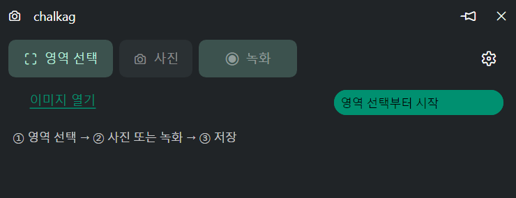
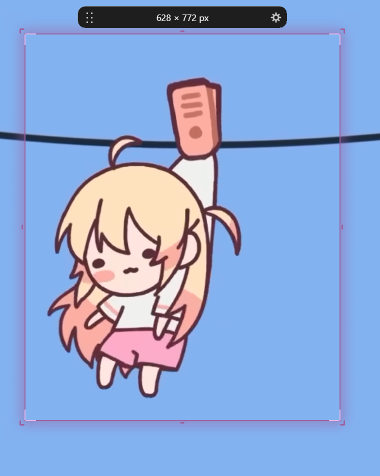
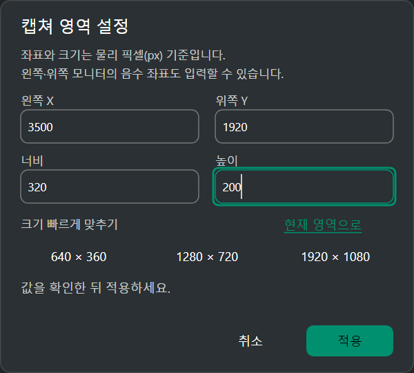
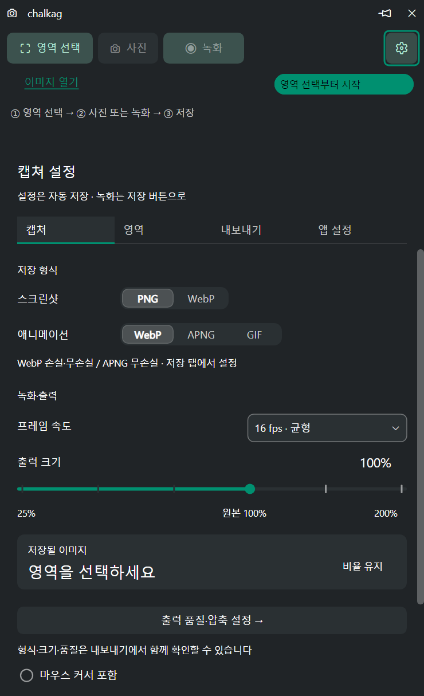
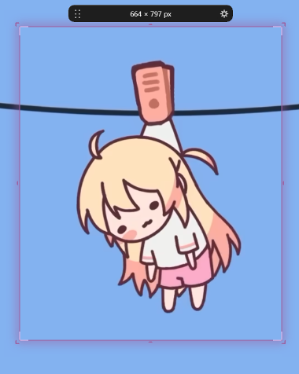
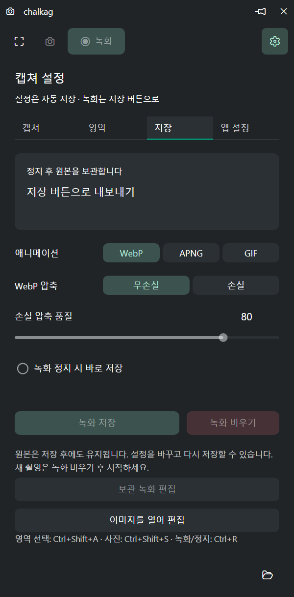
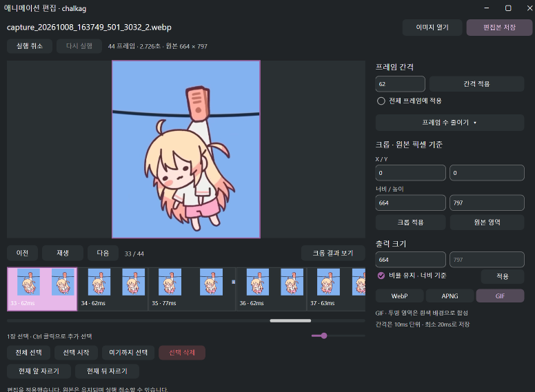
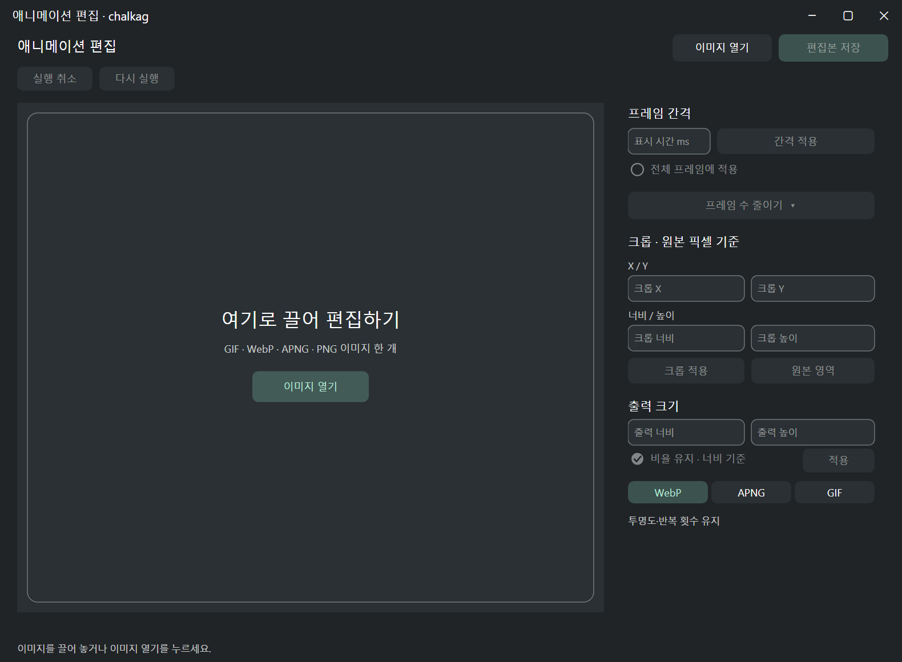

# chalkag 사용 설명서

chalkag는 화면의 한 영역을 사진이나 애니메이션 이미지로 저장하는 Windows 앱입니다.
이 설명서는 처음 촬영하는 순서부터 녹화 원본의 재저장과 애니메이션 편집까지 안내합니다.

## 1. 실행과 명령창

`chalkag.exe`를 쓰기 가능한 폴더에 넣고 실행합니다. 설치 경로 옆에 `data`가 만들어지므로
파일을 쓸 수 없는 위치에서는 설정과 이미지를 저장할 수 없습니다.

작은 명령창에는 영역 선택, 사진, 녹화·정지, 저장, 옵션 버튼과 이미지 열기 링크가 있습니다.
녹화 버튼은 녹화와 정지만 맡고, 보관 중인 녹화가 있으면 그 옆에 **저장**(저장 뒤에는 **다시 저장**) 버튼이 나타납니다.
상태 배지는 영역 선택·촬영 준비·저장 전·원본 보관을 구분합니다. 저장을 마치면 파일명 링크, **복사**, **저장 폴더 열기**가 명령창에 표시됩니다.
설정 파일·단축키 문제 같은 경고와 잠깐 보이는 알림은 저장 결과보다 먼저 같은 줄에 나타납니다.
제목줄의 핀은 명령창을 항상 위에 두는 기능입니다. **옵션**을 누르면 같은 창이 펼쳐집니다.
버튼에 포인터를 잠시 올리거나 Tab으로 초점을 옮기면 설명과 현재 단축키를 볼 수 있습니다.

| 작업 | 기본 단축키 |
| --- | --- |
| 영역 선택 | `Ctrl+Shift+A` |
| 사진 저장 | `Ctrl+Shift+S` |
| 녹화 시작·정지 | `Ctrl+R` |
| 녹화 비우기 | `Ctrl+Shift+R` |

단축키를 바꾸면 앱 설정과 툴팁에 현재 조합이 표시됩니다. 두 번째 앱 실행은 기존 명령창을 활성화합니다.

## 2. 촬영 영역 선택

1. **영역 선택** 또는 `Ctrl+Shift+A`을 누릅니다.
2. 촬영할 화면을 드래그합니다. 드래그하지 않고 창을 클릭하면 그 창의 보이는 영역을 고릅니다.
   포인터 옆 돋보기로 픽셀 위치를 확인하고, 화살표 키로 포인터를 1픽셀(Shift는 10픽셀)씩 옮길 수 있습니다.
   `Esc` 또는 오른쪽 클릭으로 선택을 취소할 수 있습니다.
3. 선택을 완료하면 영역 둘레에 프레임과 이동 핸들이 나타납니다.
4. 위쪽 핸들로 위치를 이동하고, 모서리나 변 바깥쪽을 드래그해 크기를 바꿉니다.

프레임의 가운데는 화면과 클릭이 통과합니다. 영역 안팎에 블러나 어둡게 하는 효과를 추가하지 않습니다.
녹화 중에는 영역을 변경할 수 없습니다.

아래 예제는 모서리를 드래그하여 촬영 영역의 크기를 바꾸는 모습입니다.

### 정확한 좌표·크기 입력

**옵션 → 영역 → 위치·크기 편집** 또는 프레임 핸들의 설정 버튼을 누릅니다.

X·Y는 화면상의 위치, 너비·높이는 **물리 픽셀** 단위입니다. 왼쪽이나 위쪽 보조 모니터는 음수 좌표가 될 수 있습니다.
최소 크기는 16×16입니다. 640×360, 1280×720, 1920×1080 크기 버튼으로 빠르게 맞출 수도 있습니다.
숫자를 입력하는 동안 프레임은 바뀌지 않으며 **적용**으로 확정합니다. **취소** 또는 `Esc`는 변경을 버립니다.

프레임에 초점이 있으면 방향키로 1픽셀, Shift+방향키로 10픽셀 이동합니다.
Ctrl+방향키는 크기를 변경합니다. Alt+프레임 드래그로 이동할 수도 있습니다.

자주 쓰는 영역은 영역 탭에서 **현재 영역 저장**으로 프리셋에 보관합니다.
목록에서 고른 뒤 **프리셋 적용**을 누릅니다. 이름을 입력하고 **이름 변경**으로 바꿀 수 있으며, 삭제 직후 **삭제 취소**로 복원할 수 있습니다. 최대 64개를 저장합니다.

## 3. 정지 이미지 저장

1. 영역을 선택합니다.
2. **옵션 → 캡쳐**에서 PNG 또는 WebP와 커서 포함 여부를 선택합니다. 출력 배율은 사진과 애니메이션에 함께 쓰며 내보내기 탭에서 조절합니다.
3. **사진** 또는 `Ctrl+Shift+S`를 누릅니다. 영역이 없으면 먼저 영역을 고르게 하고, 고르는 즉시 촬영합니다.
4. 저장 결과의 파일명 링크로 이미지를 열거나 **저장 폴더 열기**로 저장 폴더를 엽니다.

**사진을 클립보드에도 복사**(기본 켬)는 저장한 사진을 그림과 파일로 클립보드에 넣습니다. 저장 결과의 **복사**로 마지막 파일을 다시 넣을 수 있으며,
애니메이션은 움직임이 남도록 파일로만 넣습니다. **촬영 지연**에서 3·5·10초를 고르면 사진·녹화를 누른 뒤 그만큼 기다렸다가 시작합니다.
기다리는 동안 같은 단축키나 **취소** 버튼으로 멈출 수 있습니다.

PNG는 무손실입니다. WebP는 내보내기 탭에서 손실·무손실과 품질을 선택합니다.
출력 배율은 25·50·75·100·150·200%이며 현재 영역으로 계산한 저장 크기가 표시됩니다.
커서 포함을 켜면 촬영 당시의 마우스 포인터가 이미지에 들어갑니다.

## 4. 애니메이션 녹화와 저장

1. 영역을 선택하고 캡쳐 탭에서 FPS와 커서 포함을 설정합니다.
2. **녹화** 또는 `Ctrl+R`을 눌러 시작합니다. 명령창과 프레임이 붉은 상태로 바뀌며 경과 시간이 표시됩니다.
3. 보여 줄 동작을 진행합니다.
4. 같은 버튼이나 단축키로 정지합니다. 원본 마무리가 끝나면 녹화는 앱 안에 보관됩니다.
5. **저장** 버튼 또는 **내보내기** 탭에서 파일로 내보냅니다.

아래는 움직이는 화면을 촬영하는 예제입니다. 필요한 부분이 프레임 안에 들어오도록 영역을 맞춥니다.

FPS는 10·16·24·30·33 중에서 선택합니다. 작은 영역과 낮은 FPS는 파일 용량과 수집 부담을 줄이는 데 도움이 됩니다.
**녹화 정지 시 바로 저장**은 기본적으로 꺼져 있습니다. 켜면 정지 후 현재 출력 옵션으로 저장합니다.

저장 후에도 원본은 남습니다. 형식·출력 배율·압축 설정을 바꾼 뒤 다시 저장하면 다른 파일을 만들 수 있습니다.
원본을 보관하는 동안 수집 FPS와 커서 포함은 변경할 수 없습니다.
다음 녹화는 명령창의 **녹화** 또는 `Ctrl+R`로 시작합니다. 저장한 원본은 새 녹화로 교체하며, 아직 저장하지 않은 원본은 먼저 확인합니다.
녹화 중 디스크 부족 같은 오류로 멈추면 그때까지 녹화한 분량을 보관 원본으로 남기고 안내합니다.
보관 녹화가 있어도 사진을 찍을 수 있습니다. 원본만 비우려면 내보내기의 **녹화 비우기** 또는 `Ctrl+Shift+R`을 사용합니다. 이미 저장한 파일은 유지됩니다.

### 형식과 압축 고르기

| 형식 | 특징 |
| --- | --- |
| WebP | 손실·무손실을 선택할 수 있습니다. 사용하려는 이미지 앱이나 공유 서비스의 지원을 확인하세요. |
| APNG | PNG 기반 무손실 애니메이션입니다. 투명도와 반복 횟수를 유지합니다. |
| GIF | 최대 256색, 10ms 시간 단위를 사용합니다. 편집본의 투명 영역은 흰색 배경에 합성합니다. |

WebP 품질 1~100은 **손실 압축**에서만 적용됩니다.
**빠른 저장**은 압축 후처리를 생략하고, **균형**은 속도와 용량을 절충합니다.
**최대 압축**은 더 작은 파일을 찾으므로 오래 걸릴 수 있습니다.
메인 저장 중에는 현재 처리 단계와 진행률, **저장 취소**가 표시됩니다. 편집본 저장에는 진행 중 표시와 **취소**를 제공합니다. 취소해도 원본과 편집 내용은 유지됩니다. 진행률은 남은 시간을 뜻하는 수치가 아닙니다.

명령창과 캡쳐 프레임은 산출물에서 제외합니다. Windows의 제외 설정을 사용할 수 없는 환경에서는 겹치는 창을 숨기므로
명령창이 보이지 않아도 녹화 정지 단축키를 사용할 수 있습니다.

## 5. 애니메이션 편집

명령창의 **녹화 편집** 또는 **내보내기 → 보관 녹화 편집**으로 현재 원본을 편집합니다.
다른 파일은 명령창의 **이미지 열기**에서 바로 선택합니다. 내보내기의 **이미지를 열어 편집**으로 빈 편집창을 열 수도 있습니다.
탐색기의 GIF·WebP·APNG·PNG 파일 한 개를 설정창이나 편집창으로 끌어 놓아도 바로 열립니다.
끌어오는 동안 **여기로 끌어 편집하기** 안내가 표시됩니다. 녹화·저장·편집 작업 중에는 드롭할 수 없습니다.

이미지 열기 화면

타임라인의 프레임 폭은 표시 시간에 비례합니다. 아래 가로 스크롤과 확대 배율로 보이는 범위를 조절합니다.
프레임을 클릭하면 선택되고, Ctrl+클릭으로 추가 선택합니다. 범위 선택과 전체 선택도 사용할 수 있습니다.

### 프레임·표시 시간

- **선택 삭제**는 선택한 프레임을 제거합니다. 최소 한 프레임은 남겨야 합니다.
- 앞뒤 자르기는 현재 프레임을 유지하면서 그 앞이나 뒤를 제거합니다.
- 표시 시간을 밀리초로 입력하면 선택한 프레임에 반영합니다. **모든 프레임에 같게**는 지금 프레임의 시간을 전체에 넣습니다.
- **프레임 수 줄이기**에서 ½·⅓·¼와 남길 위치를 선택합니다. 적용 전 남는 프레임 수와 길이를 확인할 수 있습니다.

프레임 수 줄이기의 **재생 길이 유지**는 기본값입니다. 생략하는 프레임의 시간을 남은 프레임에 더하여 전체 길이를 유지합니다.
끄면 남은 프레임만 재생하므로 전체 길이가 짧아집니다. 반복 적용할 수 있고 실행 취소·다시 실행을 지원합니다.

### 크롭·출력 크기

1. 원본 미리보기 위를 드래그하거나 오른쪽 X·Y·너비·높이를 입력합니다.
2. 크롭은 드래그를 놓거나 입력을 마치면 반영됩니다. 크롭 영역은 원본 안에 있어야 하며, **크롭 해제 · 원본 전체**로 되돌립니다.
3. 필요하면 출력 너비·높이를 바꿉니다. 비율 유지는 너비를 기준으로 높이를 계산합니다.
4. 결과 미리보기로 확인하고 형식을 고른 뒤 **편집본 저장**을 누릅니다.

아래 예제는 원본 위에서 크롭 영역을 선택하고 결과 미리보기를 확인하는 모습입니다.

편집본은 `data/captures/edited_…`에 새 파일로 저장하며 원본을 덮어쓰지 않습니다.
편집창 안에서 저장 형식과 WebP 손실·무손실, 품질, 압축 속도를 조절할 수 있습니다. WebP·APNG는 투명도와 반복 횟수를 유지합니다.
표시 시간·크롭·출력 크기 입력은 잠깐 멈추거나 `Enter`를 누르면 바로 반영되고, 실행 취소로 되돌릴 수 있습니다. 프레임을 옮기거나 저장할 때도 먼저 반영합니다.
범위를 벗어난 값은 칸에 남고 배지가 **입력 확인 필요**로 바뀝니다. 값을 고치거나 **입력 되돌리기**를 누르세요. 그 밖의 배지는 **저장 전 변경**, **변경 없음**입니다.
저장 형식은 **편집본 저장** 버튼 옆에서 고릅니다. 단축키: `Ctrl+Z`/`Ctrl+Y` 실행 취소·다시 실행, `Delete` 선택 삭제, `Space` 재생, `←`/`→` 프레임 이동, `Ctrl+A` 전체 선택, `Ctrl+S` 저장.
다른 원본을 열거나 앱을 종료할 때 미저장 편집이 있으면 저장·변경 버리기·계속 편집을 선택합니다.
저장하지 않은 녹화가 있을 때 앱을 닫으면 **저장 후 종료**·**버리고 종료**·**취소**를 고릅니다. 저장 중에 닫으면 저장을 취소하고 끝낼지 묻습니다. 편집창만 닫으면 실행 중인 앱 안에 편집 내용이 남습니다.
편집 내용은 앱 재시작 후 복원되지 않으므로 필요한 결과는 파일로 저장하세요. 편집본 저장 후 **저장 파일 열기**로 결과를 확인할 수 있습니다.

## 6. 앱 설정과 데이터

앱 설정에서 시스템·밝게·어둡게 테마와 키 컬러를 선택합니다. 프레임 외곽 색에도 바로 반영됩니다.
명령창 항상 위, 프레임 글로우 두께도 앱 설정에 있습니다. **닫기 버튼을 누르면 알림 영역으로 숨기기**를 켜면 닫아도 앱이 알림 영역에 남아
단축키로 계속 촬영할 수 있습니다. 알림 영역 아이콘을 클릭하면 명령창이 다시 열리고, 오른쪽 클릭 메뉴로 촬영하거나 종료합니다.
단축키는 `Ctrl+Alt+F9` 같은 조합을 입력하고 **단축키 적용**해야 저장됩니다. 탭을 이동하거나 옵션을 접어도 적용 전 입력을 유지하며, 앱 설정 탭의 점으로 변경을 표시합니다. **변경 취소**는 저장된 조합으로 되돌립니다. 빈 값은 해당 단축키를 끕니다.
다른 앱과 충돌하거나 설정 저장이 실패하면 이전 단축키를 유지합니다.
새 기본 단축키는 처음 실행하거나 **기본값**을 선택한 뒤 **적용**할 때 사용합니다.
이미 저장된 단축키는 업데이트 후에도 유지됩니다.

| 위치 | 내용 |
| --- | --- |
| `data/settings.json` | 옵션, 단축키, 테마, 창 위치, 영역 프리셋 |
| `data/captures` | 사진, 애니메이션, 편집본 |
| `data/temp` | 녹화 원본과 저장 작업의 임시 데이터 |

모두 실행 파일 옆에 저장합니다. 앱 폴더를 옮길 때 설정도 가져가려면 `data`를 함께 옮깁니다.
소스를 공개하거나 공유할 때는 개인 설정·캡쳐가 들어 있는 `data`를 포함하지 마세요.

## 7. 문제가 생겼을 때

| 증상 | 확인할 내용 |
| --- | --- |
| 사진·녹화 버튼이 비활성 | 먼저 영역을 선택하고 진행 중인 선택·저장 작업이 끝났는지 확인합니다. 툴팁에 이유가 표시됩니다. |
| 저장 실패 | 실행 폴더 쓰기 권한과 디스크 여유 공간을 확인합니다. 저장 실패 시 보관 원본은 유지됩니다. |
| 단축키가 동작하지 않음 | 앱 설정의 충돌 안내를 확인하고 다른 조합을 적용합니다. |
| 저장한 파일 링크가 열리지 않음 | 파일이 이동·삭제되었는지, 그 형식의 기본 이미지 앱이 있는지 확인합니다. |
| 설정 파일 오류 | 앱을 종료한 뒤 `data/settings.json`을 별도로 보관하고 옮겨 기본 설정으로 시작합니다. 손상된 설정은 자동으로 덮어쓰지 않습니다. |
| 큰 애니메이션을 열 때 메모리 증가 | 사용한 미리보기를 캐시합니다. 편집창을 닫거나 다른 원본을 열면 해제됩니다. |

편집 입력은 512MiB, 이미지 화면은 33,554,432픽셀, 편집 출력 한 변은 16,383픽셀까지 지원합니다.
긴 녹화는 원본 보관용 디스크 공간이 필요합니다. 동영상·오디오, 여러 영역 동시 촬영, 프레임 삽입·교체는 지원하지 않습니다.
