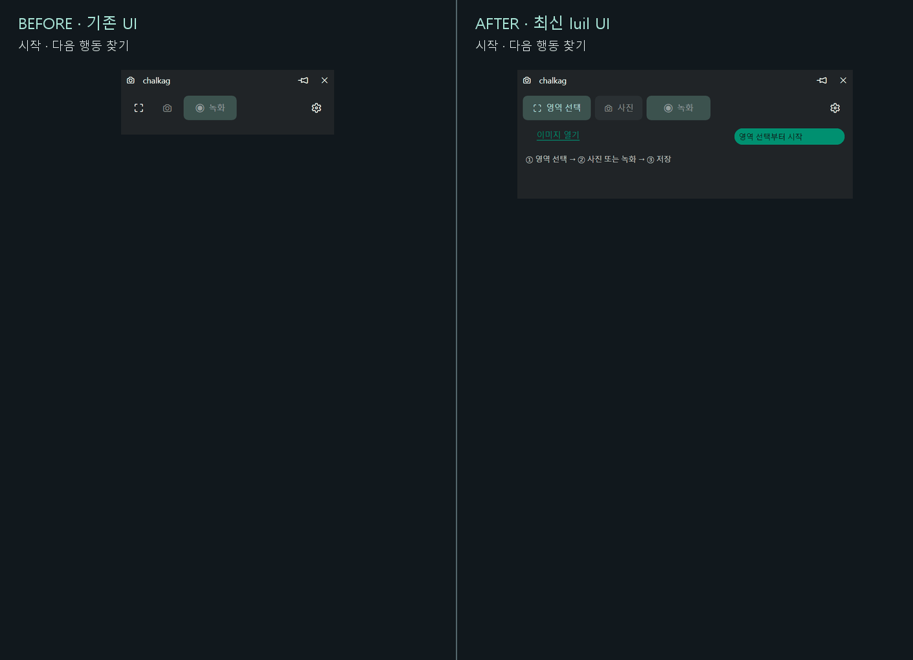
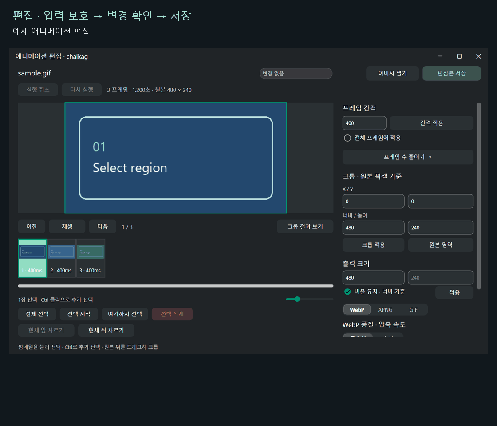
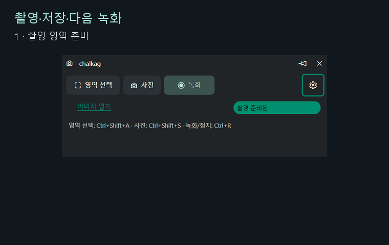

# 촬영·저장·편집 UX 개선

2026-10-27 기준 luil의 `main` 커밋 `e5dd3f308864a5da355573991761f4be84f98f02`를 적용했다.
이전 핀은 `47b508f`다. luil 소스는 직접 수정하지 않고 앱 코드와 서브모듈 핀을 변경했다.



[이전 GIF](media/ux-before.gif) · [이후 GIF](media/ux-after.gif) · [비교 정지 화면](media/ux-comparison.png)

## 달라진 흐름

| 상황 | 이전 | 이후 |
| --- | --- | --- |
| 첫 실행 | 아이콘과 비활성 버튼에서 시작 방법을 찾아야 함 | 영역 선택 텍스트, 순서 안내, 현재 상태 배지 |
| 녹화 보관 중 사진 | 보관 원본을 비우기 전에는 촬영 불가 | 보관 원본을 유지하며 사진 촬영 |
| 다음 녹화 | 비우기와 확인 후 다시 녹화 | 새 녹화, 미저장 원본 교체 전에 확인 |
| 저장 완료 | 옵션 하단에서 결과 확인 | 명령창에 완료 알림·파일 링크·폴더 열기 |
| 옵션 탐색 | 스크롤하면 탭도 사라짐 | 제목·탭을 고정하고 본문만 스크롤 |
| 출력 설정 | 배율·품질·압축 속도가 탭에 흩어짐 | 내보내기에서 형식·크기·품질·압축 속도 확인·변경 |
| 단축키 초안 | 다른 탭으로 이동하면 사라짐 | 탭 이동·옵션 접기 중 유지, 변경 표시와 명시적 취소 |
| 영역 프리셋 | 이전·다음 탐색, 자동 이름, 즉시 삭제 | 목록 선택·이름 변경·삭제 취소 |
| 편집 입력 | 적용 여부를 기억해야 함 | 적용 필요 배지, 이동·저장 전 적용 안내, 입력 되돌리기 |
| 미저장 편집 | 원본 교체·앱 종료 전에 별도 검사 없음 | 변경 표시와 저장·버리기·계속 편집 확인 |
| 편집 출력 | 메인 창의 품질 설정에 의존 | 편집창 안의 품질·압축 속도와 결과 열기 |
| 긴 저장 | 메인 저장 취소 진입점 없음 | 메인 저장 취소, 편집 처리 중 표시·취소 |
| 작은 작업 영역 | 편집창 최소 높이 730 논리 픽셀 | 기본 높이 660, 최소 840×520, 도구 본문 스크롤 |
| 접근성 | 품질·글로우 슬라이더 이름 누락 | 이름·범위·현재 값 노출 |

이어지는 탭, 탭 배지·변경 표시, 상태 배지, 완료 토스트, 테마 미리보기와 강조색 선택기,
자석 눈금 슬라이더 등 luil의 현재 컴포넌트를 사용한다. 영역 안팎의 화면에 어둡게 하기나 블러를 추가하지 않았다.
설정·프리셋·산출물은 실행 파일 옆 `data`에 계속 저장한다.

## 편집 흐름



자체 예제 GIF를 실제 편집 코드로 디코드하고 표시 시간을 변경한 뒤 파일로 내보냈다.
저장 성공 후 변경 표시 해제, 실행 취소 후 다시 미저장 상태가 되는 동작을 검사했다.
종료 확인에서 편집본 저장을 선택하면 저장 후 편집창에 머문다. 저장을 마친 뒤 종료를 다시 요청할 수 있다.

## 촬영·저장·다음 녹화



테스트 앱에 합성 화면 프레임을 입력하고 실제 녹화·정지·사진 저장·애니메이션 인코딩·다음 녹화를
UI Automation으로 실행했다. 보관 중 사진을 찍어도 녹화 원본이 남으며, 새 녹화의 미저장 상태와
이전 저장 결과를 구분한다. 합성 입력은 테스트 앱 전용이며 일반 실행 파일은 실제 화면을 수집한다.

## 촬영과 검증 범위

- 시작·영역 숫자 입력·탭 이동·단축키 입력·편집 진입은 테스트 앱을 UI Automation으로 직접 조작했다.
- GIF의 각 화면은 `PrintWindow`로 실제 앱 창을 촬영했다. 비교에는 같은 DPI와 축척을 사용했다.
- 전후 비교 GIF의 마지막 저장 완료 장면은 기존 명령창 테스트 프리뷰에 보관 원본·저장 결과 상태를 제공해 촬영했다.
- 편집 GIF의 입력·적용·종료 확인·내보내기는 실제 편집 드라이버를 사용했다. 예제와 출력은 `build/ux-flow` 아래에 있다.
- 격리 데스크톱의 실제 화면 복사는 환경 제약으로 검증하지 못했다. 별도 촬영 흐름 GIF는 합성 프레임과 실제 앱 런타임·인코더를 사용했다.
- Release·Debug 전체 빌드와 각 19개 CTest, 포맷·소스 스타일·공백 검사를 실행했다.
- UI Automation으로 단축키 초안 유지, 슬라이더 이름, 프리셋 이름 변경·선택·삭제 취소, 편집 입력 보호와 저장 결과를 확인했다.
- 실제 런타임에서 녹화·편집 종료 확인을 취소한 뒤 사진을 저장하고, 편집 변경이 유지되는 것을 확인했다.
- 여러 실제 모니터 사이의 혼합 DPI 이동과 대용량 파일의 체감 저장 시간은 별도 환경 확인이 필요하다.

## GIF 다시 만들기

`CHALKAG_BUILD_TESTS=ON`으로 빌드한 전후 테스트 앱을 각각 독립된 폴더에 보관한다.
UIA 헬퍼는 `luil-uia` 스킬의 `scripts/uia.ps1`을 기본으로 사용하며 `-HelperPath`로 바꿀 수 있다.

```powershell
./scripts/capture_ux_flow.ps1 -Executable <이전-test-app.exe> -Output build/ux-flow/before/frames -Variant before
./scripts/capture_ux_flow.ps1 -Executable <이후-test-app.exe> -Output build/ux-flow/after/frames -Variant after
./scripts/capture_ux_states.ps1 -Executable <이전-command-help-tests.exe> -Output build/ux-flow/before/saved
./scripts/capture_ux_states.ps1 -Executable <이후-command-help-tests.exe> -Output build/ux-flow/after/saved
./scripts/capture_ux_states.ps1 -Executable <이후-command-help-tests.exe> -Output build/ux-flow/editor -Scenario editor -Sample <예제.gif>
./scripts/capture_recording_flow.ps1 -Executable <이후-test-app.exe> -Output build/ux-flow/recording/frames
python scripts/render_ux_comparison.py build/ux-flow/before build/ux-flow/after docs/media --editor build/ux-flow/editor --recording build/ux-flow/recording/frames
```

렌더 도구에는 Python·Pillow와 Windows의 맑은 고딕이 필요하다. 촬영 헬퍼는 격리 데스크톱을 사용하고
완료 후 테스트 앱과 작업 프로세스를 닫는다. GIF는 단계별 실제 창 캡쳐를 재생하는 형식이다.
